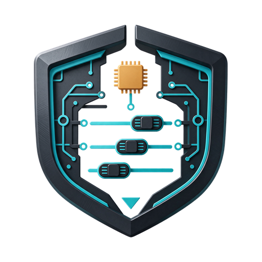

<div align="center">
  
  <h1>CS2 Control Center</h1>
  <p>Protótipo experimental para diagnóstico e demonstração de ajustes de Windows e BIOS/UEFI.</p>
  <p><strong>Rust · eframe/egui · Windows 10/11</strong></p>
</div>

> **Estado atual:** protótipo de interface e regras de segurança. Os controles do Windows são uma simulação em memória; a área de BIOS/UEFI é somente diagnóstico. Esta versão não altera configurações do Windows nem grava no firmware.

## Visão geral

O CS2 Control Center explora uma interface desktop para administrar configurações de sistema com limites de segurança explícitos. A implementação atual prioriza estados conhecidos, correspondência precisa de hardware e reversões que não sobrescrevam mudanças feitas por outra pessoa ou ferramenta.

| Área | O que existe nesta versão | O que ainda não faz |
| --- | --- | --- |
| Ajustes do Windows | Interface e demonstração local em memória | Não lê nem altera Registro, serviços ou configurações do Windows |
| BIOS / UEFI | Aba de diagnóstico e regras para comparar perfis | Não varre variáveis de firmware e não escreve na BIOS/UEFI |
| Coleta de hardware | Script PowerShell local, somente leitura | Não envia dados automaticamente |

## Logo

Marca original do protótipo, criada para identificar o projeto; não representa nem substitui marcas de terceiros.

## Começar

É necessário ter o toolchain Rust instalado. No terminal, na raiz deste repositório:

```powershell
cd cs2-tuner
cargo test
cargo run
```

Para compilar uma versão otimizada destinada ao Windows, execute em um ambiente Windows 10/11 com a toolchain Rust apropriada:

```powershell
cargo build --release
```

> A entrega-base relata **8 testes aprovados** e um build em Linux. **O aplicativo ainda não foi validado no Windows.** Um build Linux não comprova o funcionamento ou a compilação final do alvo Windows.

## O que está implementado

- Interface nativa com abas separadas para **Ajustes do Windows** e **BIOS / UEFI**.
- Estados de ajuste para ativo, desativado, parcial, incompatível, reinicialização necessária e desconhecido.
- Proteções para não reaplicar um valor que já está no alvo e para bloquear a reversão se o estado atual divergir do que o aplicativo aplicou.
- Distinção entre valor anterior conhecido e vazio (`Some("")`) e valor anterior desconhecido (`None`), que não pode ser revertido com segurança.
- Regras de fingerprint de BIOS que exigem correspondência exata do sistema, placa-mãe, firmware, configuração do processador e módulos de memória; dados incompletos mantêm o modo diagnóstico.
- Coletor PowerShell baseado em consultas CIM locais somente leitura. Ele omite números de série, UUIDs e identificadores de rede; o código também coleta fabricante e part number dos módulos de memória.

## Limites e segurança

**Os botões da aba Windows apenas alteram o estado da demonstração em memória.** Não há catálogo de tweaks validado nem adaptador de leitura/escrita do Registro ou de serviços. A aba BIOS/UEFI não faz varredura e não há caminho de escrita.

O script `cs2-tuner/docs/coletar-hardware.ps1` produz JSON localmente. Revise o resultado antes de compartilhá-lo: embora não colete números de série, UUIDs ou identificadores de rede, contém detalhes do computador e da configuração de hardware.

SCEWIN e SCEHUB não estão incorporados, não são invocados e não foram copiados. Qualquer uso futuro depende de verificação independente de licença e autorização de redistribuição.

## Estrutura do repositório

```text
.
├── assets/                         # marca do projeto
├── cs2-tuner/
│   ├── Cargo.toml                  # manifesto Rust
│   ├── Cargo.lock                  # dependências fixadas
│   ├── src/                        # interface e regras de estado/BIOS
│   ├── docs/arquitetura.md         # fronteiras de segurança e desenho
│   └── docs/coletar-hardware.ps1   # coletor local somente leitura
└── source-materials/
    └── cs2-tuner-prototype.zip     # pacote original preservado, sem alterações
```

O README original do protótipo continua em `cs2-tuner/README.md`. Os arquivos `README.md` e `coletar-hardware.ps1` fornecidos separadamente foram comparados com as cópias dentro do ZIP e são idênticos.

## Próximos passos sugeridos

1. Executar o coletor em uma máquina Windows e revisar o JSON antes de compartilhá-lo.
2. Validar uma combinação exata de hardware e firmware, sem habilitar escrita de BIOS.
3. Definir e testar qualquer ajuste do Windows individualmente, incluindo leitura, impacto, reinicialização e reversão segura.
4. Fazer build e testes em Windows 10/11 e documentar os resultados.
5. Decidir a licença do projeto e verificar direitos de qualquer dependência ou ferramenta externa antes de redistribuí-la.

## Licença

**Nenhuma licença foi escolhida ou declarada para este repositório.** O repositório é público conforme solicitado, mas a visibilidade pública não concede por si só uma licença de uso ou redistribuição. Nenhum arquivo de licença foi adicionado; confirme os direitos do código e das dependências antes de reutilizá-los.

## Documentação

- [README original do protótipo](cs2-tuner/README.md)
- [Arquitetura e fronteiras de segurança](cs2-tuner/docs/arquitetura.md)
- [Coletor de hardware PowerShell](cs2-tuner/docs/coletar-hardware.ps1)
- [Pacote original preservado](source-materials/cs2-tuner-prototype.zip)
